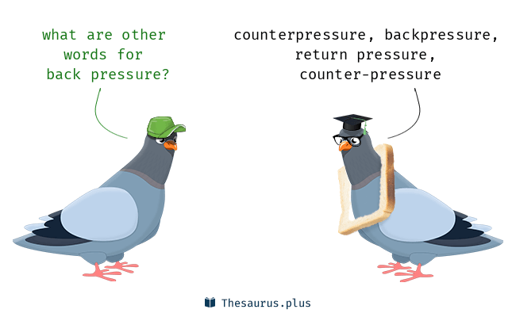

## 什么是 GenStage
一个库，一系列 protocol，类似 GenServer。

## 怎么用 GenStage
像实现 GenServer 那样去实现自己的 producer，consumer 和 producer-consumer。

## 为啥用 GenStage
Producer 是根据下游的处理能力和需求来生产数据，避免 back pressure。

## 什么是 back pressure
网上的定义很多，我觉得就是：
```
上游给下游的工作量超过下游的处理能力
```

## 参考
https://elixirschool.com/en/lessons/data_processing/genstage

